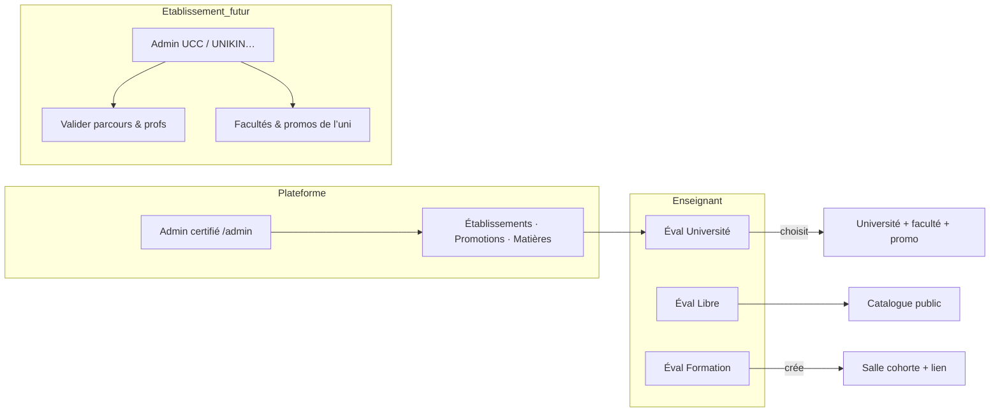

# LawApp

Plateforme d’**évaluations sécurisées** (Vue 3, TypeScript, Tailwind) pour **universités**, **formateurs indépendants** et **étudiants** — avec anti-triche, codes d’accès et double espace enseignant / étudiant.

---

## Architecture produit



| Acteur | Rôle |
|--------|------|
| **Super admin plateforme** | Compte `certified` → `/admin` : référentiels globaux, **liste publique** des universités (GET public), partenaires activés pour les profs. |
| **Admin établissement** | Rôles par université → `/institution` : valider **professeurs** et **étudiants**, référentiels locaux (spec API). |
| **Enseignant** | Créer évaluations et (pour les formations) **ses salles**. |
| **Étudiant** | Parcours académique (uni) ou rejoindre une **salle** via lien (formation). |

---

## Trois façons de publier une évaluation

| Publication | Enseignant fait quoi ? | Étudiant voit quoi ? |
|-------------|-------------------------|----------------------|
| **Libre** | Publie dans le **catalogue ouvert** ; salle optionnelle (présence). | « Catalogue & codes » (même parcours en attente : libres OK). |
| **Université** | Choisit **université + faculté + promotion** dans les listes **admin** — **ne crée pas** promo/faculté. | « Pour vous » si parcours **validé** et match promo/faculté. |
| **Formation** | Crée la **salle cohorte en même temps** que l’épreuve (ou en choisit une existante) ; partage le **lien** d’invitation. | « Mes formations » — **hors** catalogue public. |

Implémentation UI : `CreateEvaluationView.vue` (étape Publication), salles : `CoursesView.vue`.

---

## Fonctionnalités principales

### Comptes & espaces
- Inscription / connexion ; un compte peut être **enseignant et étudiant** (switch d’espace).
- Parcours étudiant optionnel : université · faculté · promotion (`pending` → `verified`).

### Enseignant
- Évaluations : QCM, vrai/faux, réponse courte, dépôt document ; chrono ; anti-triche.
- Salles : type **Université** ou **Formation** (`/teacher/courses`).
- Publication : libre / université / formation (voir ci-dessus).

### Étudiant
- Catalogue libre, épreuves ciblées (« Pour vous »), formations (« Mes formations »), code prof.
- Passation sous chrono avec journal des violations (local / API selon mode).

### Super admin (`/admin`, compte certifié)
- Référentiels : **établissements**, **promotions**, matières, devises (`AdminCatalogPanel`).
- Toggles **liste publique** / **partenaire** par établissement (`platformGovernance`).
- Catégories, validation enseignants plateforme, certification comptes.

### Admin université (`/institution`, rôles établissement)
- Tableau de bord dédié (files d’affiliation prof/étudiant à brancher sur l’API).
- Accès depuis **Compte → Sécurité & accès** si `institutionMemberships` est renseigné.

### Anti-triche
- Onglet / focus, copier-coller, plein écran, seuil de violations.

---

## Documentation

| Ressource | Description |
|-----------|-------------|
| [docs/README.md](./docs/README.md) | Index + schémas |
| [docs/backend-user-journeys-api.md](./docs/backend-user-journeys-api.md) | Parcours & API backend |
| [docs/admin-referentiels-universites.md](./docs/admin-referentiels-universites.md) | Admin, uni, formations |
| [docs/gouvernance-multi-tenant.md](./docs/gouvernance-multi-tenant.md) | Super admin, GET public, rôles par université |
| [docs/presence-qr-sessions.md](./docs/presence-qr-sessions.md) | Présence QR, relais CP, examens « présents only » |

**Aperçu navigateur** (cover, recherche, Mermaid, thème LawApp) :

```bash
npm run docs          # PC uniquement → http://localhost:4174
npm run docs:lan      # même WiFi / mobile → http://<IP-PC>:4174
```

Guide détaillé : [docs/partage-documentation.md](./docs/partage-documentation.md)

Dans Cursor : ouvrir un `.md` sous `docs/` → `Ctrl+Shift+V` (aperçu Markdown).

---

## Démarrage

```bash
npm install
npm run dev
```

[http://localhost:5173](http://localhost:5173)

Mode **API** : `VITE_USE_API=true` (défaut). Mode démo local : `VITE_USE_API=false`.

### Parcours rapide (démo)

1. Enseignant → créer éval **Libre** → publier → copier le code.
2. Étudiant → code → passer l’épreuve.

**Formation** : enseignant → créer éval **Formation** → nommer la salle à l’étape Publication → étudiant rejoint via lien salle → « Mes formations ».

**Université** : admin crée promos/établissements (API) → enseignant → éval **Université** → choisit uni/faculté/promo → étudiant avec parcours validé → « Pour vous ».

---

## Build

```bash
npm run build
npm run preview
```

---

## Stack

- Vue 3 + TypeScript + Vite  
- Tailwind CSS v4  
- Vue Router + Pinia  
- Backend Spring (intégration partielle — voir spec doc)

---

## Note technique

En mode API, le **type de salle** (formation vs université) et la **publication** (université / cohorte) sont encore complétés côté front après `POST` évaluation tant que le backend n’expose pas tous les champs — voir [docs/backend-user-journeys-api.md](./docs/backend-user-journeys-api.md).
