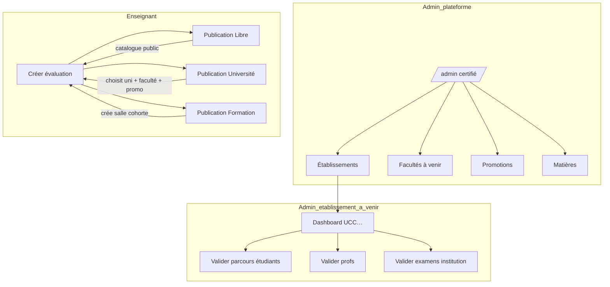

# Documentation LawApp

Spécifications produit et technique pour **LawApp** : évaluations sécurisées, universités, formations et admin multi-tenant.

**Guides rapides :**

- [Parcours & API backend](backend-user-journeys-api.md)
- [Admin & référentiels](admin-referentiels-universites.md)
- [Gouvernance multi-tenant](gouvernance-multi-tenant.md)
- [Présence QR](presence-qr-sessions.md)
- [Partager sur mobile / LAN](partage-documentation.md)

## Lire en local

```bash
npm run docs
```

→ [http://localhost:4174](http://localhost:4174) (PC uniquement)

**Partager sur téléphone / même WiFi :**

```bash
npm run docs:lan
```

Puis ouvrir `http://<IP-de-votre-PC>:4174` — détail : [Partager la documentation](partage-documentation.md).

Dans Cursor : ouvrir un `.md` sous `docs/` → aperçu Markdown (`Ctrl+Shift+V`).

## Architecture produit (résumé)



### Trois types de publication (enseignant)

| Type | Référentiels | Salle | Visible où (étudiant) |
|------|--------------|-------|------------------------|
| **Libre** | — | Optionnel (cours) | Catalogue & codes |
| **Université** | Admin : établissement, faculté, promotion — **le prof ne crée rien** | Non | « Pour vous » (parcours validé) |
| **Formation** | — | **Créée avec l’évaluation** (ou existante) | « Mes formations » (lien salle) |

### Rôles

- **Super admin plateforme** (`certified`) : référentiels globaux, visibilité universités.
- **Admin établissement** : files d’affiliation, validation (voir gouvernance).
- **Enseignant** : évaluations + salles formation.
- **Étudiant** : parcours académique (uni) ou adhésion salle (formation).

## Index des fichiers

| Document | Contenu |
|----------|---------|
| [Parcours utilisateurs & API backend](./backend-user-journeys-api.md) | Spec intégration Spring, affiliations, examens |
| [Admin, référentiels & universités](./admin-referentiels-universites.md) | Admin plateforme vs établissement, salles, cohortes |
| [Gouvernance multi-tenant](./gouvernance-multi-tenant.md) | Super admin, rôles par université |
| [Présence QR](./presence-qr-sessions.md) | QR rotatif, CP, check-in |
| [Partager la doc](./partage-documentation.md) | LAN, mobile, ngrok |
