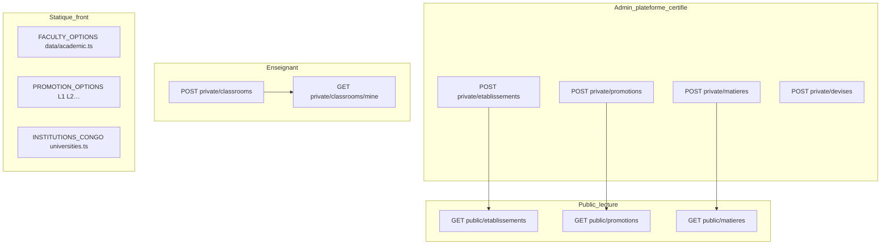
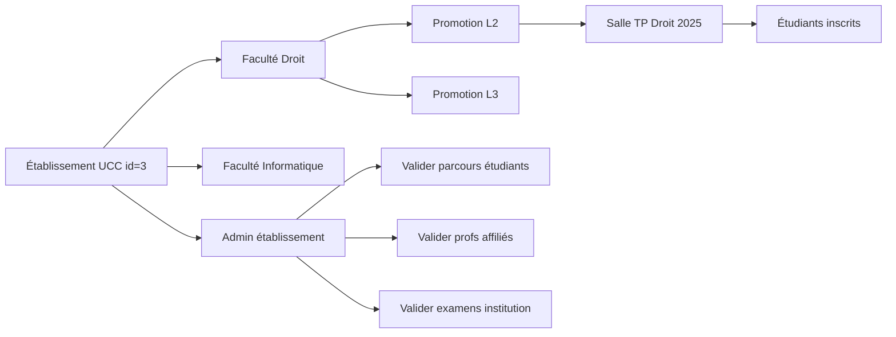
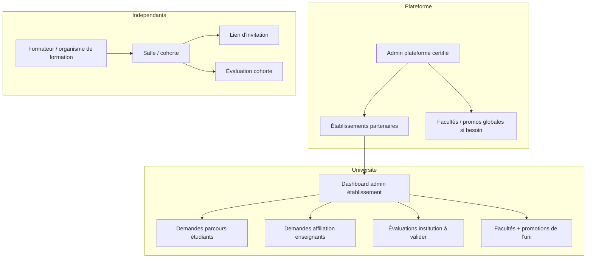

# Admin, référentiels & universités — état actuel vs cible

Ce document répond à : *pourquoi l’admin semble vide*, *où créer facultés / promotions / salles*, *quelle API pour les universités*, et *comment chaque établissement devrait fonctionner*.

---

## 1. Pourquoi l’admin « paraît vide »

### Accès

| Condition | Effet |
|-----------|--------|
| Compte **non certifié** | Redirection vers `/account` — pas d’accès `/admin`. |
| `VITE_USE_API=false` (mode démo) | Une seule bannière : *« Activez VITE_USE_API=true »* — **aucun panneau** (référentiels, catégories, etc.). |
| API activée + compte **certifié** | Tableau de bord complet. |

L’admin LawApp n’est **pas** (encore) l’admin **UCC / UNIKIN** : c’est l’admin **plateforme** (super-utilisateur certifié via `PUT protected/certification/{userId}`).

### Menu admin aujourd’hui

| Page | Rôle |
|------|------|
| `/admin` | Référentiels, catégories, documents, validation enseignants, récupération / certification comptes |
| `/admin/evaluations` | Liste globale des évaluations API |
| `/admin/submissions` | Soumissions globales |

**Pas encore dans le menu :** validation parcours étudiants, affiliations enseignants, facultés, gestion des salles globales, admin **par université**.

---

## 2. Où est quoi aujourd’hui (front + API)

### Tableau synthèse

| Donnée | Création UI | Liste / lecture | API backend | Remarque |
|--------|-------------|-----------------|-------------|----------|
| **Université / établissement** | Admin → panneau « Établissements » | `GET public/etablissements` | `POST private/etablissements` | Prof enseignant : liste API mais **seule l’UCC est sélectionnable** (`universities.ts`). Parcours étudiant : liste **statique** RDC, pas l’API. |
| **Promotion** (L2 Droit…) | Admin → « Promotions » | `GET public/promotions` | `POST private/promotions` | Profil étudiant « parcours » utilise **L1/L2 statiques**, pas la liste API — **décalage**. |
| **Faculté** | **Nulle part** | `FACULTY_OPTIONS` en dur | **Aucune API** | Droit, Informatique, etc. — fichier `src/data/academic.ts`. |
| **Salle / classe** | **Enseignant** (cours / salles), pas admin | `GET private/classrooms/mine` | `POST private/classrooms` | C’est la « salle » pour audience `classroom` et `criteres.classroomId` sur une éval. |
| **Matière** | Admin + suggest enseignant | `GET public/matieres` | `POST private/matieres` | OK |
| **Type enseignant** | — | `GET public/teacher-types` | — | Profil enseignant |
| **Devises** | Admin | `GET public/payment/devises` | `POST private/devises` | Paiement / premium |

Code admin référentiels : `src/components/admin/AdminCatalogPanel.vue` + `src/stores/catalog.ts` + `src/api/catalog.ts`.

---

## 3. Ce que fait l’admin **aujourd’hui** (API ON)

### Référentiels (`AdminCatalogPanel`)

- Créer et lister **matières**, **promotions**, **établissements**, **devises**.
- Les listes publiques alimentent surtout le **profil enseignant** (établissement API) et la **création de matière**.

### Modération plateforme (`AdminDashboardView`)

- **Certifier** un utilisateur (accès admin).
- **Récupérer** un compte supprimé.
- **Valider** la fiche enseignant (`PUT protected/teachers/validation`).
- **Catégories** contenu / documents.

### Ce que l’admin **ne fait pas** encore

- Créer des **facultés**.
- Lier promotion ↔ **université** (promotions globales aujourd’hui).
- Valider **parcours étudiant** (pending → verified).
- Valider **affiliation enseignant** à l’établissement.
- Valider **évaluations institution**.
- Gérer les **salles** (réservé aux enseignants).

---

## 4. Comment **chaque université** devrait fonctionner (cible produit)

Aujourd’hui les établissements API sont une **liste plate** : pas de « tenant » isolé côté front. La cible logique :

### Rôles

| Rôle | Périmètre |
|------|-----------|
| **Admin plateforme** (certifié) | Crée des établissements partenaires, matières globales, modération extrême. |
| **Admin établissement** (à créer) | Facultés + promotions **de son** université ; valide parcours / profs / examens officiels. |
| **Enseignant** | Rattaché à un établissement **verified** ; crée **salles** et évaluations ; cible promo / faculté / salle. |
| **Étudiant** | Choisit **établissement + faculté + promotion** (API) ; pending puis verified ; voit libres + ciblées si match. |

### Règle d’or multi-universités

Toute entité scolarité devrait porter **`etablissementId`** :

- Faculté : `{ id, etablissementId, name }`
- Promotion : `{ id, etablissementId, facultyId?, name }` (ex. « L2 » peut exister par faculté)
- Parcours étudiant : `{ etablissementId, facultyId, promotionId, status }`
- Salle : `{ id, etablissementId?, teacherId, name, promotionId? }`

Ainsi **UCC** et **UNIKIN** ne partagent pas les mêmes promos mélangées dans un seul `GET public/promotions` sans filtre.

---

## 5. API existantes (universités & co.)

Base : `/api/v1` (voir `src/api/catalog.ts`).

| Action | Méthode | Route | Qui appelle |
|--------|---------|-------|-------------|
| Lister universités | GET | `public/etablissements` | Public ; profil enseignant ; (devrait) parcours étudiant |
| Créer université | POST | `private/etablissements` | Admin certifié |
| Lister promotions | GET | `public/promotions` | Public ; (devrait) profil étudiant |
| Créer promotion | POST | `private/promotions` | Admin certifié |
| Lister matières | GET | `public/matieres` | Création éval |
| Créer matière | POST | `private/matieres` | Admin / enseignant |
| Salles du prof | GET | `private/classrooms/mine` | Enseignant |
| Créer salle | POST | `private/classrooms` | Enseignant |
| Membres salle | POST | `private/classrooms/users` | Enseignant |

### API **à prévoir** (backend + futurs écrans admin établissement)

| Besoin | Route suggérée |
|--------|----------------|
| Facultés d’une université | `GET public/faculties?etablissementId=` |
| CRUD faculté | `POST private/etablissements/{id}/faculties` |
| Promotions **par** établissement (ou faculté) | `GET public/promotions?etablissementId=` |
| Activer partenaire (UCC, UNIKIN…) | `PUT private/etablissements/{id}` `{ partner: true, active: true }` |
| File parcours pending | `GET private/etablissements/{id}/student-paths?status=pending` |
| Valider parcours | `PUT …/student-paths/{id}/verify` |
| Admin établissement | rôle + JWT scoped `etablissementId` |

---

## 6. Incohérences front à corriger (intégration)

| Écran | Problème | Correction |
|-------|----------|------------|
| `StudentAcademicAffiliationCard` | Universités = `INSTITUTIONS_CONGO`, promos = `PROMOTION_OPTIONS` | `listEtablissements()` + `listPromotions(etablissementId)` |
| `CreateEvaluationView` (faculté) | `FACULTY_OPTIONS` statique | `GET faculties?etablissementId=` |
| `InstitutionAffiliationCard` | Clés string statiques | `etablissementId` API + sync affiliation serveur |
| Admin | Pas de CRUD facultés | Panneau ou sous-espace **admin établissement** |

---

## 7. Deux mondes sur la même plateforme

La plateforme doit servir **deux filières** sans les confondre dans l’UI ni dans les règles d’accès.

| Dimension | **Université (officiel)** | **Indépendant (formation)** |
|-----------|---------------------------|-----------------------------|
| Identité organisateur | Enseignant **affilié** établissement | Enseignant **sans** établissement ou « organisateur » |
| Référentiels | Facultés + promotions **par** `etablissementId` | Pas de faculté / promo obligatoire |
| Entrer dans le groupe | Parcours académique validé (UCC · Droit · L2) | **Lien de salle** (+ éventuellement code épreuve) |
| Type d’évaluation | Souvent `institution` + audience promo/faculté | **Hors catalogue universitaire** : cohorte privée |
| Modération | Admin **établissement** | Modération **plateforme** (signalement, certified) uniquement |
| Visible dans « Catalogue libre » étudiant | Non (ciblé) | **Non** — seulement membres de la salle |

**Recommandation de vocabulaire produit**

- Éviter de dire seulement « libre » pour la formation privée : aujourd’hui « libre » = visible sans parcours validé dans le **catalogue ouvert**.
- Introduire un troisième concept explicite, par exemple :
  - `publicationScope`: `open_catalog` | `institution` | **`cohort`** (formation / salle privée)
  - ou `audienceMode`: **`cohort`** + `classroomId` obligatoire, **exclu** de `GET repondre` global.

L’indépendant crée une **salle** (déjà `POST private/classrooms`), partage un **lien** (`/join/...`), les apprenants **adhèrent** à la salle ; l’évaluation est réservée à `classroomId` + optionnellement code — **sans** validation scolarité.

---

## 8. Dashboard **par université** (demandes d’affiliation)

Chaque établissement partenaire dispose d’un espace **admin établissement** (distinct de `/admin` plateforme).

### Files d’attente typiques

| File | Demandeur | Action admin établissement |
|------|-----------|----------------------------|
| Parcours académique | Étudiant (faculté, promotion) | Approuver / refuser → `verified` / rejected |
| Affiliation enseignant | Prof (département, justificatif) | Approuver → peut publier au nom de l’uni |
| Publication évaluation | Enseignant verified | Approuver si `publicationScope: institution` |

### APIs suggérées (scoped par `etablissementId` du admin connecté)

- `GET private/etablissements/me/dashboard/summary`
- `GET private/etablissements/me/student-path-requests?status=pending`
- `PUT private/etablissements/me/student-path-requests/{id}` `{ action: verify | reject }`
- Idem `teacher-affiliation-requests`, `evaluation-publication-requests`

**Avantage :** la scolarité UCC ne voit **que** UCC ; pas de mélange avec UNIKIN. La plateforme reste tierce neutre.

### Référentiels côté admin

| Niveau | Facultés | Promotions |
|--------|----------|------------|
| **Admin plateforme** | Peut créer des modèles ou désactiver | Idem (peu usé si tout est par uni) |
| **Admin établissement** | CRUD **facultés de son uni** | CRUD **promotions** liées à faculté ou établissement |

**Règle UI enseignant (implémentée)** : pour une évaluation **Université**, le prof **sélectionne** uniquement établissement + faculté + promotion (`CreateEvaluationView`) — il **ne crée pas** ces entrées. Pour une évaluation **Formation**, il **crée la salle cohorte** sur le même écran (ou en choisit une existante).

Les promotions créées aujourd’hui en `/admin` sans `etablissementId` devraient évoluer vers **promotions rattachées** pour que « L2 » à UCC ≠ « L2 » ailleurs.

---

## 9. Parcours **formateur indépendant** (formation + lien)

### Parcours utilisateur

1. S’inscrire en **enseignant** (pas d’obligation d’établissement).
2. Créer une **salle / cohorte** (« Formation droit du travail — mars 2026 »).
3. Copier le **lien d’invitation** ; les apprenants ouvrent le lien, créent compte étudiant (ou se connectent) et **rejoignent la salle**.
4. Créer une évaluation :
   - **Pas** dans le catalogue public universitaire ;
   - Audience = **membres de cette salle** ;
   - Option : code épreuve en plus du lien salle ;
   - Pas de validation admin établissement.
5. Les apprenants voient l’épreuve dans **« Mes formations / Ma salle »**, pas dans « Catalogue & codes » global.

### Règles d’accès (serveur)

- `joinBlockReason` : membre de `classroomId` **ou** invitation token valide ;
- **Ne pas** exiger `studentAcademicAffiliation.verified` ;
- **Ne pas** inclure dans `GET evaluations/repondre` catalogue ouvert ;
- Parcours pending côté uni **n’empêche pas** de passer une éval de cohorte (activité hors université).

### Proximité avec le code actuel

| Déjà là | À renforcer |
|---------|-------------|
| `POST private/classrooms`, lien join cours | Type salle `cohort` vs `university_class` |
| `audienceMode: classroom`, `requireEnrollment` | Flag `excludeFromOpenCatalog` |
| `requiresAccessCode` | Combinaison lien salle + code |

**Avis produit :** modèle **sain et différenciant** — même moteur d’examen (chrono, anti-triche, QCM) pour **universités** et **formateurs privés**, sans forcer les indépendants dans le parcours UCC · L2.

---

## 10. Parcours admin **cible** (résumé pour le backend)

1. **Plateforme** crée l’établissement partenaire (ex. UCC) et les comptes admin établissement.
2. **Admin établissement** crée facultés et promotions **scoped** ; traite files pending étudiants / enseignants / évals institution.
3. **Étudiant universitaire** choisit parcours (API) → pending → verified → évals ciblées.
4. **Formateur indépendant** crée salle + lien → évals **cohort** sans passage par scolarité.
5. **Admin plateforme** modère abus, certifie comptes, gère partenaires — pas les demandes UCC au quotidien.

---

## 11. Fichiers utiles

| Sujet | Fichier |
|-------|---------|
| Dashboard admin | `src/views/admin/AdminDashboardView.vue` |
| Référentiels | `src/components/admin/AdminCatalogPanel.vue` |
| API catalogue | `src/api/catalog.ts` |
| Salles | `src/api/classrooms.ts`, `src/stores/classrooms.ts` |
| Facultés / promos statiques | `src/data/academic.ts` |
| Liste universités statique | `src/data/universities.ts` |
| UCC seule sélectionnable (prof) | `isPartnerEtablissementName()` |
| Spec parcours & affiliations | `docs/backend-user-journeys-api.md` |

---

*Dernière mise à jour : modèle dual université / formateur indépendant ; dashboard établissement pour affiliations ; facultés + promos scoped admin.*
