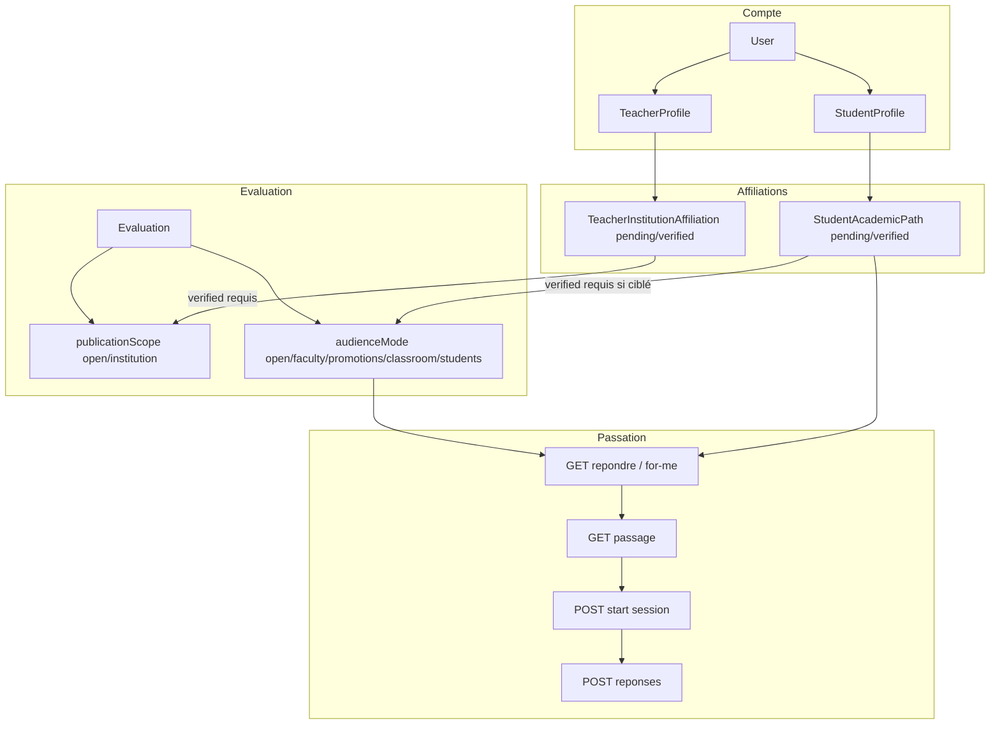

# LawApp — Parcours utilisateurs & cahier d’API backend

Document de référence pour l’équipe **backend** et la **intégration front**.  
Objectif : aligner les API sur ce que le front affiche déjà, en expliquant **pourquoi** chaque brique apporte de la valeur (produit, sécurité, exploitation).

---

## Sommaire

1. [Résumé exécutif](#1-résumé-exécutif)
2. [Qui gagne quoi ?](#2-qui-gagne-quoi)
3. [État actuel vs cible](#3-état-actuel-vs-cible)
4. [Architecture logique](#4-architecture-logique)
5. [Règles métier (source de vérité serveur)](#5-règles-métier-source-de-vérité-serveur)
6. [Parcours utilisateurs détaillés](#6-parcours-utilisateurs-détaillés)
7. [Catalogue des endpoints](#7-catalogue-des-endpoints)
8. [Modèle de données à étendre](#8-modèle-de-données-à-étendre)
9. [Contrat d’erreurs](#9-contrat-derreurs)
10. [Checklist intégration front](#10-checklist-intégration-front)
11. [Priorisation & livraisons](#11-priorisation--livraisons)
12. [Glossaire](#12-glossaire)

---

## 1. Résumé exécutif

LawApp est une plateforme d’**évaluations** (QCM, ouvertes, cas pratiques) avec :

- un **même compte** pouvant être enseignant **et** étudiant ;
- des épreuves **libres** (ouvertes à tous) ou **liées à un établissement** ;
- un **ciblage** (faculté, promotion, salle, étudiants nommés) ;
- un **parcours académique étudiant** validé par l’établissement (`pending` → `verified`).

Le **front Vue 3** implémente déjà ces parcours en mode démo (**localStorage**) et une partie en **mode API** (auth, création d’évaluation, passage, soumissions).  
Les fonctionnalités **récentes** (affiliations, publication institution, audience, règles pending/libre/ciblé) sont surtout **côté front** : elles disparaissent si l’utilisateur change d’appareil ou si un étudiant contourne l’UI.

**Message clé pour le backend :**  
Persister et **appliquer** ces règles sur le serveur, ce n’est pas du confort — c’est ce qui rend le produit **crédible** face à Moodle, Inspera ou un LMS maison : une seule vérité, auditable, multi-appareils, prête pour l’international.

### Avantages globaux d’un backend aligné

| Avantage | Explication concrète |
|----------|----------------------|
| **Cohérence multi-appareils** | Parcours validé, brouillons institution, listes « Pour vous » identiques sur mobile, PC, navigateur privé. |
| **Sécurité pédagogique** | Un étudiant ne peut pas appeler `POST …/reponses` sur une épreuve ciblée L2 Droit s’il est L1 Médecine non validé — même en modifiant le front. |
| **Confiance des établissements** | Validation enseignant + validation évaluation institution = workflow vendable (UCC, facultés, scolarité). |
| **Support & debug** | « Je ne vois pas l’examen » → on vérifie `me.academicPath.status` et `GET repondre`, pas le cache local. |
| **Évolutivité internationale** | SSO, SCIM, LTI s’accrochent à des entités serveur (établissement, promo, affiliation), pas à du JSON local. |
| **Intégrité des examens** | Session `start` + horloge serveur + violations en base = litiges réduits, reprise après coupure réseau possible. |

---

## 2. Qui gagne quoi ?

### 2.1 Étudiant

| Situation | Sans API métier | Avec API métier |
|-----------|-----------------|-----------------|
| Parcours en attente | Risque de listes vides ou incohérentes selon appareil | **Libres** toujours visibles ; **ciblées** absentes jusqu’à validation — message clair |
| Code prof pour promo | Peut parfois « marcher » en local alors que scolarité dit non | Refus **403** explicite : parcours non validé ou mauvaise promo |
| Reprise après crash | Session perdue | Session serveur + reprise si `start` / `submission` idempotents |
| Confiance | « L’app a bugué » | « L’établissement ne m’a pas encore validé » — statut vérifiable |

**Avantage ressenti :** moins de frustration, moins de sentiment d’injustice, parcours lisible (bandeau + catalogue libre).

### 2.2 Enseignant

| Situation | Sans API métier | Avec API métier |
|-----------|-----------------|-----------------|
| Publier pour son établissement | Brouillon seulement sur son navigateur | Brouillon **serveur** + file de validation établissement |
| Cibler L2 Informatique | Filtrage front facilement contournable | Seuls les étudiants **verified** L2 Info voient / passent |
| Suivi des copies | Déjà partiel via `submissions` | + lien audience + violations anti-triche pour décisions disciplinaires |
| Réputation | « Les étudiants trichent / voient tout » | Publication maîtrisée, codes expirés côté serveur |

**Avantage ressenti :** contrôle réel de la diffusion, moins de support manuel (WhatsApp « envoie le code » à tort).

### 2.3 Établissement (admin / scolarité — rôle futur)

| Capacité | Intérêt |
|----------|---------|
| Valider parcours étudiant | Évite les faux L2, intrus aux examens de promo |
| Valider enseignant | Seuls les profs affiliés publient au nom de l’université |
| Valider évaluation institution | L’université « co-signe » l’épreuve officielle |
| Statistiques agrégées | Taux de participation, violations — sans accès aux copies individuelles (RGPD) |

**Avantage :** le produit passe de « outil prof » à **infrastructure d’examens** rachetable par une direction IT.

### 2.4 Équipe technique

| Rôle | Avantage |
|------|----------|
| **Backend** | Contrat stable (`me`, `repondre`, codes d’erreur) ; moins de « hacks » front |
| **Front** | Suppression des `patchCurrentUser` / `updateEvaluation` après POST ; une source de vérité |
| **Ops** | Logs centralisés : join refusé, submit refusé, affiliation verify |
| **Produit** | Démo locale conservée (`VITE_USE_API=false`) ; prod = même UX, données serveur |

---

## 3. État actuel vs cible

### 3.1 Déjà branché (front → API existante)

Référence code : `src/api/*.ts`, `src/stores/evaluations.ts`.

| Domaine | Endpoints (préfixe `/api/v1` sauf auth) |
|---------|----------------------------------------|
| Auth | `POST /auth/login`, `register`, refresh, OTP, `public/password/forgot|verify|reset` |
| Profil session | `GET protected/me`, `POST protected/students/me/academic-path`, `POST protected/teachers/me/institution-affiliation` |
| Découverte étudiant | `GET protected/evaluations/for-me`, `POST protected/evaluations/resolve-code` |
| Admin établissement | `GET private/etablissements/{id}/affiliation-requests`, verify/reject profs & parcours |
| Évaluations | `POST private/evaluations`, `GET protected/evaluations/repondre`, `…/{id}/passage`, `POST …/reponses` |
| Copies enseignant | `GET private/evaluations/{id}/submissions`, notes |
| Référentiels | `public/etablissements`, `promotions`, `matieres` |
| Salles | `classrooms` (CRUD / users) |
| Étudiants (liste) | `GET protected/students?promotionId&etablissementId` |

**Point d’attention sécurité (déjà géré front) :**  
Ne pas faire passer l’étudiant par `GET public/evaluations` pour réviser — les QCM y exposent les bonnes réponses. Le flux officiel est **`repondre` + `passage`**.

### 3.2 Prévu UI mais non (ou mal) persisté serveur

| Concept front (`src/types`) | Où c’est stocké aujourd’hui en mode API |
|-----------------------------|----------------------------------------|
| `teacherInstitutionAffiliation` | localStorage via `auth.patchCurrentUser` |
| `studentAcademicAffiliation` | idem |
| `publicationScope`, `institutionPublicationPending` | local sur l’évaluation après `POST private/evaluations` |
| `audienceMode`, faculté, promos, salle, IDs étudiants | idem |
| `accessCodeExpiresAt` | calcul front (`evaluationAudience.ts`) |
| `requireEnrollment`, `presentOnly` (cours) | surtout `courseStore` local |
| Violations anti-triche à la soumission | session front ; pas toujours envoyées |

**Conséquence :** deux enseignants sur le même compte API ne voient pas le même brouillon institution ; un étudiant validé sur le poste scolarité n’est pas validé dans LawApp tant que l’API ne le reflète pas.

### 3.3 Cible

Toutes les lignes du tableau §3.2 deviennent **entités ou champs API**, avec **filtrage sur `repondre`, `passage`, `reponses`, `resolve-code`**.

---

## 4. Architecture logique



**Lecture du schéma :**  
Les affiliations **ne bloquent pas** la création de compte ; elles **conditionnent** publication institution et accès aux épreuves ciblées. Les épreuves **libres** contournent le parcours pour la **visibilité et la passation** (règle produit actuelle), pas pour tricher sur une épreuve **ciblée**.

---

## 5. Règles métier (source de vérité serveur)

Le front reproduit ces règles dans `src/utils/evaluationAudience.ts` et `src/utils/access.ts`. **Le serveur doit les réimplémenter** (ne pas faire confiance au client).

### 5.1 Parcours étudiant

| Statut | Voir évals **libres** | Voir évals **ciblées** | Rejoindre / passer **libre** | Rejoindre / passer **ciblée** |
|--------|----------------------|------------------------|--------------------------------|----------------------------------|
| Aucun parcours | Oui (catalogue ouvert) | Non | Oui* | Non |
| **pending** | Oui | Non | Oui | Non (403) |
| **verified** | Oui | Oui si match audience | Oui | Oui si match |

\* Sous réserve dates, statut `active`, tentatives max, etc.

**Avantage de centraliser :**  
Scolarité valide une fois → **tous** les clients (web, futur mobile) appliquent la même règle ; plus de ticket « ça marche sur le tel de mon copain ».

### 5.2 Affiliation enseignant

| `publicationScope` | Enseignant | Résultat attendu |
|--------------------|------------|------------------|
| `open` | any | Publication active (sous réserve droits créateur) |
| `institution` | affiliation **pending** ou autre établissement | Brouillon ou `pending_institution_review` — **invisible** étudiants |
| `institution` | affiliation **verified** même établissement | Peut publier ; éventuelle **double validation** établissement sur l’épreuve |

**Avantage :** l’université ne voit pas des examens « officiels » publiés par un prof non affilié.

### 5.3 Audience (matching)

Modes (`EvaluationAudienceMode`) :

- `open` — éval libre (audience ouverte).
- `faculty` — faculté étudiante doit matcher (normalisation insensible casse/accents ; ex. Informatique).
- `promotions` — une des promos ciblées (L2, M1…).
- `classroom` — étudiant membre de la salle (`classroomId`).
- `students` — liste blanche `userId` / `studentId`.

**Avantage :** remplace WhatsApp + code pour 200 étudiants — la liste « Pour vous » devient automatique et fiable.

### 5.4 Code d’accès

- Optionnel (`criteres.accessCode` ou code dérivé `EV{id}` côté front).
- Expiration : `min(availableUntil, availableFrom + duration)` ou champ explicite `accessCodeExpiresAt`.

**Avantage serveur :** après la date, **403 CODE_EXPIRED** même si quelqu’un a capturé le code sur une affiche.

### 5.5 Anti-triche

Config `anticheat` (déjà envoyée à la création). À la soumission :

- enregistrer `violations[]` ;
- appliquer seuils (`failImmediately`, etc.) **côté serveur** en plus du front.

**Avantage :** preuve en cas de contestation ; statistiques par épreuve ; correction manuelle éclairée.

---

## 6. Parcours utilisateurs détaillés

Chaque parcours suit le modèle : **Étapes utilisateur → Front aujourd’hui → API attendue → Avantages**.

---

### Parcours A — Inscription, connexion, double rôle

#### A1. Inscription

1. L’utilisateur crée un compte (email, mot de passe, identité, téléphone).
2. (UI) Il indique qu’il veut devenir enseignant et/ou étudiant.
3. Vérification email (OTP) si activée.
4. Redirection vers complétion de profil(s).

| Front | `RegisterView` → `auth.registerAccount` → `POST /auth/register` |
| API existante | Oui |
| Gap | Pas de `intendedRoles` obligatoire ; acceptable en v1 |

**Avantages si login/`me` enrichi ensuite :**  
Un seul compte pour enseigner le matin et passer un MOOC l’après-midi — **sans double email** — standard des plateformes pro.

#### A2. Connexion & choix d’espace

1. Login → JWT + refresh.
2. Front lit `member.profile` → `hasTeacherProfile`, `hasStudentProfile`.
3. Dernier espace mémorisé (`teacher` / `student`) ou choix via `RoleWorkspaceSwitcher`.
4. Si aucun profil métier → onboarding.

| Front | `auth.loginViaApi`, `memberProfile.ts`, `App.vue` sync catalogue étudiant |
| API attendue | **`GET protected/me`** (profil complet + affiliations — voir §8) |

**Avantages :**

- **Support :** « Connectez-vous et allez dans Profil » — le statut pending/verified est celui du serveur.
- **Sécurité :** le token porte l’identité ; les qualités ne sont plus reconstituées depuis localStorage incohérent.

---

### Parcours B — Affiliations & parcours académique

#### B1. Enseignant — rattachement établissement

1. Profil enseignant → sélection établissement (`listEtablissements` + clé `institutionKey` UI).
2. Statut **pending** → alertes (`TeacherInstitutionAlerts`).
3. Admin établissement valide → **verified**.
4. L’enseignant peut publier des évals `publicationScope: institution`.

| Front aujourd’hui | `requestTeacherInstitutionAffiliation()` → **localStorage uniquement** en API |
| API à créer | Voir §7.1 |

**Avantages :**

- **Commercial :** « Les examens officiels UCC passent par validation scolarité » — argument B2B.
- **Juridique :** traçabilité de qui a approuvé quel prof (audit log).
- **Technique :** le front supprime le patch local ; rechargement page = même état.

#### B2. Étudiant — parcours université · faculté · promotion

1. Profil → université, faculté, promotion, salle optionnelle.
2. **pending** : bandeau dashboard ; catalogue **libres** ; pas de « Pour vous ».
3. **verified** : « Pour vous » + évals ciblées matchantes.

| Front | `StudentAcademicAffiliationCard`, `StudentDashboardView`, `getStudentParcoursJoinBlockReason` |
| API à créer | Voir §7.2 |

**Avantages :**

- **Pédagogie :** les examens de promo ne fuient plus vers des étudiants hors promo.
- **UX claire :** pending n’est plus « aucune évaluation » mais « libres OK, ciblées après validation » — moins d’abandon.
- **Données :** `GET protected/students` peut être filtré par promo **et** statut verified pour l’enseignant qui cible des noms.

#### B3. Admin établissement (écran futur — API dès maintenant)

1. Liste des demandes **pending** (profs + étudiants + évals institution).
2. Approuver / refuser avec motif.
3. Notification étudiant/prof (email / in-app).

**Avantages :** débloque un **troisième persona** payeur (direction IT / scolarité), pas seulement l’enseignant individuel.

---

### Parcours C — Enseignant : créer, cibler, publier

#### C1. Création d’épreuve

1. Assistant multi-étapes : infos, questions, anti-triche, publication & audience.
2. Mode API : `POST private/evaluations` (questions, anticheat, `criteres`).
3. **Puis aujourd’hui** : le front ajoute en local `publicationScope`, `audienceMode`, etc.

| Fichiers | `CreateEvaluationView.vue`, `stores/evaluations.ts` `createEvaluationOnApi` |
| Cible | **Tout** dans le body POST/PUT (§8) |

**Avantages :**

- **Collaboration :** un autre prof admin ou co-auteur (futur) voit la même config.
- **Versioning :** historique des modifications avant publication — réduction des litiges énoncé.
- **Import LTI futur :** metadata audience dans la même entité.

#### C2. Publication institution en attente

1. Prof choisit « Lié à établissement » sans affiliation verified.
2. Front : `status: draft`, `institutionPublicationPending: true`.
3. Après validations (prof + établissement) → `active`.

**Avantage :** pas d’examen « fantôme » visible sur le réseau étudiant avant validation officielle.

#### C3. Partage code & lien

1. Enseignant copie code / QR / lien join.
2. Expiration automatique liée au calendrier de l’épreuve.

**Avantage serveur :** codes révoqués ou expirés **centralisément** (annulation session, force majeure).

---

### Parcours D — Étudiant : découvrir, rejoindre, passer

#### D1. Dashboard — « Pour vous » vs « Catalogue & codes »

1. **Pour vous** : évals ciblées, parcours **verified**, non terminées.
2. **Catalogue** : évals **libres** ; en API = liste `repondre` filtrée (ou endpoint dédié).
3. Actualiser → `syncStudentCatalog()`.

| Front API | `GET protected/evaluations/repondre` uniquement |
| Gap | Pas de distinction libre/ciblée dans le summary API → sections UI incomplètes en prod |

**API recommandée :**

- Enrichir chaque entrée de `repondre` avec `audienceMode`, `isOpenAudience`, `requiresAccessCode`.
- Option : `GET protected/evaluations/for-me` pour la section « Pour vous ».

**Avantages :**

- **Performance :** listes plus petites (for-me vs tout le catalogue).
- **Clarté produit :** l’étudiant comprend la différence examen promo vs exercice libre.

#### D2. Saisie d’un code

1. Étudiant entre le code prof.
2. Front résout : cache → catalogue → `public/{id}` (métadonnées sans réponses) → contrôles → `passage`.
3. Blocage si pending sur éval **ciblée** ; **libre** autorisée.

| Front | `StudentDashboardView.lookupCode`, `getEvaluationJoinBlockReason` |
| API recommandée | `POST protected/evaluations/resolve-code` retourne `{ evaluationId, canJoin, blockReasonCode }` |

**Avantages :**

- **UX :** message d’erreur identique UI / API (`PARCOURS_PENDING`, etc.).
- **Sécurité :** pas besoin d’exposer `public/evaluations` à l’étudiant pour valider un code.

#### D3. Intro & passage

1. `GET …/passage` — questions sans bonnes réponses.
2. (Recommandé) `POST …/start` — session serveur, `expiresAt`.
3. Examen : chrono, anti-triche.
4. `POST …/reponses` + violations.

**Avantages session serveur :**

- **Équité :** horloge unique (fin de créneau global respectée).
- **Reprise :** après coupure, reprise sur même `submissionId` brouillon (spec à définir).
- **Analytics :** temps réel sur combien d’étudiants sont en cours.

#### D4. Historique & résultats

Déjà partiellement API via submissions côté enseignant ; étudiant : historique local + sync à prévoir (`GET protected/me/submissions`).

**Avantage :** portfolio étudiant portable (mobilité inter-facultés).

---

### Parcours E — Enseignant : correction & exports

1. Liste copies → détail → notes (`…/submissions/…/notes`).
2. Correction manuelle PDF (front local) → à migrer vers upload serveur.

**Avantage :** les étudiants voient la correction **au même endroit** que la note, notifiés quand publiée.

---

### Parcours F — Présence QR & salle

**Spec détaillée (produit + API + UI/UX) :** [presence-qr-sessions.md](./presence-qr-sessions.md).

Résumé :

1. L’enseignant **démarre une session de présence** sur une salle (`classroomId`) avec **durée max** (ex. 5 min).
2. Un **QR rotatif** (~15 s) et un **code numérique** synchronisés sont servis par le backend ; le prof affiche sur tablette / projecteur.
3. **Relais étudiants (CP)** : à l’**instant T**, le prof recherche un inscrit et **autorise l’affichage** ; même QR synchronisé ; **révocation** possible avant la fin de session.
4. Les étudiants **scannent** depuis LawApp **web ou mobile** (compte authentifié) ou saisissent le code numérique.
5. À la **clôture** (durée max ou bouton), plus de slots ; scans tardifs → log `SESSION_CLOSED` + **explication** étudiant → file **Tentatives** côté prof. Scans avec slot expiré → `SLOT_EXPIRED` (message court, log optionnel).
6. Évaluation **`presentOnly`** : `resolve-code` / `start` exigent un `PresenceCheckIn` sur la session liée (ou règle salle + date).

Le front legacy lie encore évaluation ↔ WiFi local (`PresenceSessionPanel`, `presentOnly` + `courseStore`) — migration vers registre serveur décrite dans le doc présence.

**Avantage API :** examen « présents only » **défendable** (registre horodaté) ; fonctionne **sans projecteur** (relais) ; traçabilité des tentatives frauduleuses ou tardives.

---

## 7. Catalogue des endpoints

Préfixe par défaut : `/api/v1`. Auth : `/api/auth/…`.  
Les routes **existantes** ne sont pas re-décrites ; focus sur **nouvelles / extensions**.

### 7.1 Affiliation enseignant

| Method | Path | Description |
|--------|------|-------------|
| POST | `protected/teachers/me/institution-affiliation` | Body: `{ etablissementId }` → status pending |
| GET | `protected/teachers/me/institution-affiliation` | État courant |
| PUT | `private/etablissements/{etabId}/teacher-affiliations/{id}/verify` | Admin |
| PUT | `private/etablissements/{etabId}/teacher-affiliations/{id}/reject` | Admin, `{ reason? }` |

### 7.2 Parcours académique étudiant

| Method | Path | Description |
|--------|------|-------------|
| POST | `protected/students/me/academic-path` | `{ etablissementId, facultyId \| facultyName, promotionId, classroomId? }` |
| GET | `protected/students/me/academic-path` | Parcours + `status`, dates |
| PUT | `private/etablissements/{etabId}/student-paths/{id}/verify` | Scolarité |
| PUT | `private/etablissements/{etabId}/student-paths/{id}/reject` | Scolarité |
| GET | `public/faculties?etablissementId=` | Liste facultés (remplace liste statique front) |

### 7.3 Profil session

| Method | Path | Description |
|--------|------|-------------|
| GET | `protected/me` | User + teacher + student + affiliations + academicPath |

### 7.4 Évaluation — publication & audience

| Method | Path | Description |
|--------|------|-------------|
| POST | `private/evaluations` | **Extension body** §8 |
| PUT | `private/evaluations/{id}` | Mise à jour |
| PUT | `private/evaluations/{id}/publish` | Active + contrôles affiliation |
| PUT | `private/etablissements/{etabId}/evaluations/{id}/approve` | Validation établissement |
| GET | `private/evaluations/mine` | Liste créateur avec statuts |

### 7.5 Étudiant — découverte & passation

| Method | Path | Description |
|--------|------|-------------|
| GET | `protected/evaluations/repondre` | **Enrichi** + filtrage serveur pending/ciblé |
| GET | `protected/evaluations/for-me` | (Optionnel) Ciblé verified uniquement |
| GET | `protected/students/me/evaluations/calendar.ics` | (Prévu) Flux iCal abonnement — mêmes filtres que `repondre` + `availableFrom`/`Until` |
| POST | `protected/evaluations/resolve-code` | `{ code }` → metadata + droit join |
| POST | `protected/evaluations/{id}/start` | Crée session, retourne `sessionId`, `expiresAt` |
| GET | `protected/evaluations/{id}/passage` | Existant |
| POST | `protected/evaluations/{id}/reponses` | **Extension** violations + timestamps |

### 7.6 Admin établissement

| Method | Path | Description |
|--------|------|-------------|
| GET | `private/etablissements/{id}/affiliation-requests` | Query: `status=pending`, `type=teacher\|student\|evaluation` |

### 7.7 Sessions de présence (QR dynamique)

Voir [presence-qr-sessions.md](./presence-qr-sessions.md) §7 et §8 (UI). Auth : enseignant propriétaire de la salle ; étudiant inscrit pour check-in ; grant actif pour `display` relais.

| Method | Path | Description |
|--------|------|-------------|
| POST | `protected/classrooms/{classroomId}/presence-sessions` | Body: `{ maxDurationSeconds, slotRotationSeconds?, evaluationId? }` → `{ sessionId, status: "open", openedAt }` |
| GET | `protected/presence-sessions/{sessionId}` | Détail session + counts |
| GET | `protected/presence-sessions/{sessionId}/display` | Slot courant : `{ slot, expiresAt, numericCode, qrToken, sessionRemainingSeconds }` — enseignant ou relais non révoqué |
| POST | `protected/presence-sessions/{sessionId}/close` | Fermeture anticipée |
| GET | `protected/presence-sessions/{sessionId}/check-ins` | Liste `{ studentUserId, checkedInAt, relayUserId? }` |
| POST | `protected/presence-sessions/{sessionId}/relays` | Body: `{ studentUserId }` → grant |
| DELETE | `protected/presence-sessions/{sessionId}/relays/{studentUserId}` | Révoque relais |
| POST | `protected/presence-sessions/{sessionId}/check-in` | Body: `{ token }` → `201` present ou `403` + `code` |
| POST | `protected/presence-sessions/{sessionId}/attempts` | Body: `{ token?, code, explanation? }` — log tentative ; `explanation` requis si `SESSION_CLOSED` |
| GET | `protected/presence-sessions/{sessionId}/attempts` | Query: `reasonCode?` — pour UI prof |

**Extension évaluation (publish / PUT) :**

```json
{
  "presentOnly": true,
  "classroomId": 12,
  "requiredPresenceSessionId": "uuid-optional"
}
```

Si `requiredPresenceSessionId` absent : règle métier « dernière session **closed** du jour pour `classroomId` » (à documenter côté Spring).

---

## 8. Modèle de données à étendre

### 8.1 Réponse `GET protected/me` (exemple)

```json
{
  "user": {
    "userId": 42,
    "email": "marie@example.com",
    "firstName": "Marie",
    "lastName": "Kabila",
    "phone": "+243…",
    "city": "Kinshasa",
    "certified": false,
    "premium": false
  },
  "teacher": {
    "teacherId": 7,
    "typeTeacherId": 1,
    "departement": "Droit",
    "institutionAffiliation": {
      "etablissementId": 3,
      "label": "UCC",
      "status": "verified",
      "requestedAt": "2026-09-01T10:00:00Z",
      "verifiedAt": "2026-09-05T14:00:00Z"
    }
  },
  "student": {
    "studentId": 12,
    "matricule": "2024-001",
    "academicPath": {
      "etablissementId": 3,
      "label": "UCC",
      "facultyId": 2,
      "facultyLabel": "Informatique",
      "promotionId": 4,
      "promotionLabel": "L2",
      "classroomId": 55,
      "status": "pending",
      "requestedAt": "2026-09-10T08:00:00Z"
    }
  }
}
```

**Mapping front :** `src/types/auth.ts` (`InstitutionAffiliation`, `StudentAcademicAffiliation`).

### 8.2 Extension création / lecture évaluation

Champs à ajouter à l’entité (noms Java au choix, garder cohérence OpenAPI) :

| Champ | Type | Notes |
|-------|------|--------|
| `publicationScope` | `open` \| `institution` | |
| `linkedEtablissementId` | long | Si institution |
| `institutionPublicationStatus` | enum | ex. `none`, `pending_review`, `approved` |
| `audienceMode` | enum | open, faculty, promotions, classroom, students |
| `audienceFacultyId` | long? | |
| `audiencePromotionIds` | long[]? | |
| `audienceClassroomId` | long? | |
| `audienceStudentUserIds` | long[]? | |
| `accessCode` | string? | |
| `accessCodeExpiresAt` | instant? | |
| `status` | draft \| active \| closed | |

**Réponse POST** : renvoyer **tous** ces champs pour que le front **n’appelle plus** `updateEvaluation` local après création.

### 8.3 Soumission

```json
{
  "answers": [ { "questionId": 1, "selectedOptionId": 3 } ],
  "startedAt": "2026-09-28T09:00:00Z",
  "submittedAt": "2026-09-28T10:00:00Z",
  "timeSpentSeconds": 3600,
  "clientSessionId": "550e8400-e29b-41d4-a716-446655440000",
  "violations": [
    { "type": "tab_switch", "timestamp": "2026-09-28T09:15:00Z", "message": "Changement d'onglet" }
  ]
}
```

---

## 9. Contrat d’erreurs

Format uniforme pour messages UI (`STUDENT_PARCOURS_PENDING_MESSAGE`, etc.) :

```json
{
  "message": "Votre parcours n'est pas encore validé.",
  "code": "PARCOURS_PENDING",
  "details": { "evaluationId": 99, "requiredStatus": "verified" }
}
```

| Code | HTTP | Usage front |
|------|------|-------------|
| `PARCOURS_PENDING` | 403 | Éval ciblée ou code ciblé |
| `AUDIENCE_MISMATCH` | 403 | Mauvaise promo / faculté |
| `INSTITUTION_NOT_VERIFIED` | 403 | Prof ou éval institution |
| `CODE_EXPIRED` | 403 | Code hors délai |
| `EVALUATION_CLOSED` | 403 | Statut ou dates |
| `MAX_ATTEMPTS` | 403 | Tentatives épuisées |
| `SESSION_EXPIRED` | 403 | Chrono serveur |
| `PRESENCE_REQUIRED` | 403 | Éval `presentOnly` sans check-in |
| `PRESENCE_SESSION_CLOSED` | 403 | Scan après fin session → UI formulaire explicatif |
| `PRESENCE_SLOT_EXPIRED` | 403 | QR obsolète (&lt; 15 s) — rescanner |
| `PRESENCE_INVALID_TOKEN` | 403 | QR falsifié ou corrompu |
| `PRESENCE_RELAY_REVOKED` | 403 | Écran relais plus autorisé |
| `PRESENCE_NOT_ENROLLED` | 403 | Étudiant non inscrit à la salle |

**Avantage :** traduction i18n future branchée sur `code`, pas sur parsing de texte français.

---

## 10. Checklist intégration front

Quand le backend livre une brique, le front modifie :

| Brique backend | Fichiers front principaux | Action |
|----------------|---------------------------|--------|
| `GET protected/me` | `stores/auth.ts`, `utils/sessionMeMapper.ts` | Hydrater affiliations au login + refresh |
| Academic path API | `StudentAcademicAffiliationCard.vue`, `api/academicPath.ts` | Branché (mode API) |
| Teacher affiliation API | `InstitutionAffiliationCard.vue`, `api/teacherAffiliation.ts` | Branché (mode API) |
| Evaluation audience POST | `CreateEvaluationView.vue`, `evaluationApiMapper.ts` | Body complet ; retirer patch local |
| `repondre` + `for-me` | `stores/evaluations.ts`, dashboard | Split « Pour vous » / catalogue |
| `resolve-code` | `StudentDashboardView.vue`, `resolveAccessCodeForStudent` | Branché (mode API) |
| `start` session | `ExamView.vue`, `ExamIntroView.vue` | Horloge + id session serveur |
| Violations submit | `useAntiCheat.ts`, store submit | Payload étendu |
| Sessions présence QR | `PresenceSessionPanel.vue` → live + `/presence/*` | Voir [presence-qr-sessions.md](./presence-qr-sessions.md) §8, §10 |
| Gate `presentOnly` API | `access.ts`, `resolve-code`, `start` | Vérifier check-ins serveur |

**Mode démo :** conserver `VITE_USE_API=false` — parcours identique, données locales (`src/data/demoSeed.ts`) ; mock présence QR en vague P1–P3.

---

## 11. Priorisation & livraisons

| Vague | Livrable | Avantage business immédiat |
|-------|----------|----------------------------|
| **1** | `GET me` + academic path + teacher affiliation + verify admin | Parcours pending/verified **réels** — fin des incohérences multi-appareils |
| **2** | Evaluation publication/audience persistée + filtre `repondre` | Dashboard étudiant **correct en prod** ; vente établissement |
| **3** | `resolve-code`, règles 403, `start` session | Examens **équitables** et défendables |
| **4** | Violations + idempotence submit | Anti-triche **crédible** |
| **5** | Console admin + notifications | Acteur **scolarité** et renouvellement licence |
| **6** | Présence QR + relais + gate `presentOnly` | Examens **sur place** sans projecteur ; spec [presence-qr-sessions.md](./presence-qr-sessions.md) |

---

## 12. Glossaire

| Terme | Signification |
|-------|----------------|
| **Libre / open audience** | Évaluation accessible sans match promo/faculté (parcours pending OK). |
| **Ciblée** | Audience faculty, promotions, classroom ou students. |
| **Parcours** | `StudentAcademicAffiliation` : établissement + faculté + promotion (+ salle). |
| **Affiliation enseignant** | Lien prof ↔ établissement pour publier au nom de l’université. |
| **repondre** | Liste des épreuves que l’étudiant **peut** passer (sans fuites QCM). |
| **passage** | Feuille d’examen sans bonnes réponses. |
| **Workspace** | Espace UI enseignant ou étudiant (même compte). |
| **Session de présence** | Fenêtre QR rotatif + registre `present` pour une salle. |
| **Relais (CP)** | Grant temporaire permettant d’afficher le même QR qu’à l’enseignant. |
| **Slot** | Validité ~15 s d’un QR / code numérique avant rotation. |

---

## Références code front

| Sujet | Fichier |
|-------|---------|
| Types évaluation / audience | `src/types/index.ts` |
| Types user / affiliations | `src/types/auth.ts` |
| Règles pending / libre / ciblé | `src/utils/evaluationAudience.ts` |
| Join & accès | `src/utils/access.ts` |
| Publication institution | `src/utils/institutionAffiliation.ts` |
| Store évaluations + sync API | `src/stores/evaluations.ts` |
| Client API évaluations | `src/api/evaluations.ts` |
| Création éval enseignant | `src/views/teacher/CreateEvaluationView.vue` |
| Dashboard étudiant | `src/views/student/StudentDashboardView.vue` |
| Feature flag API | `src/config/features.ts` |

---

*Document généré pour synchronisation front/back LawApp. Dernière mise à jour : Parcours F présence QR + endpoints §7.7 ; détail UI/API dans presence-qr-sessions.md.*
