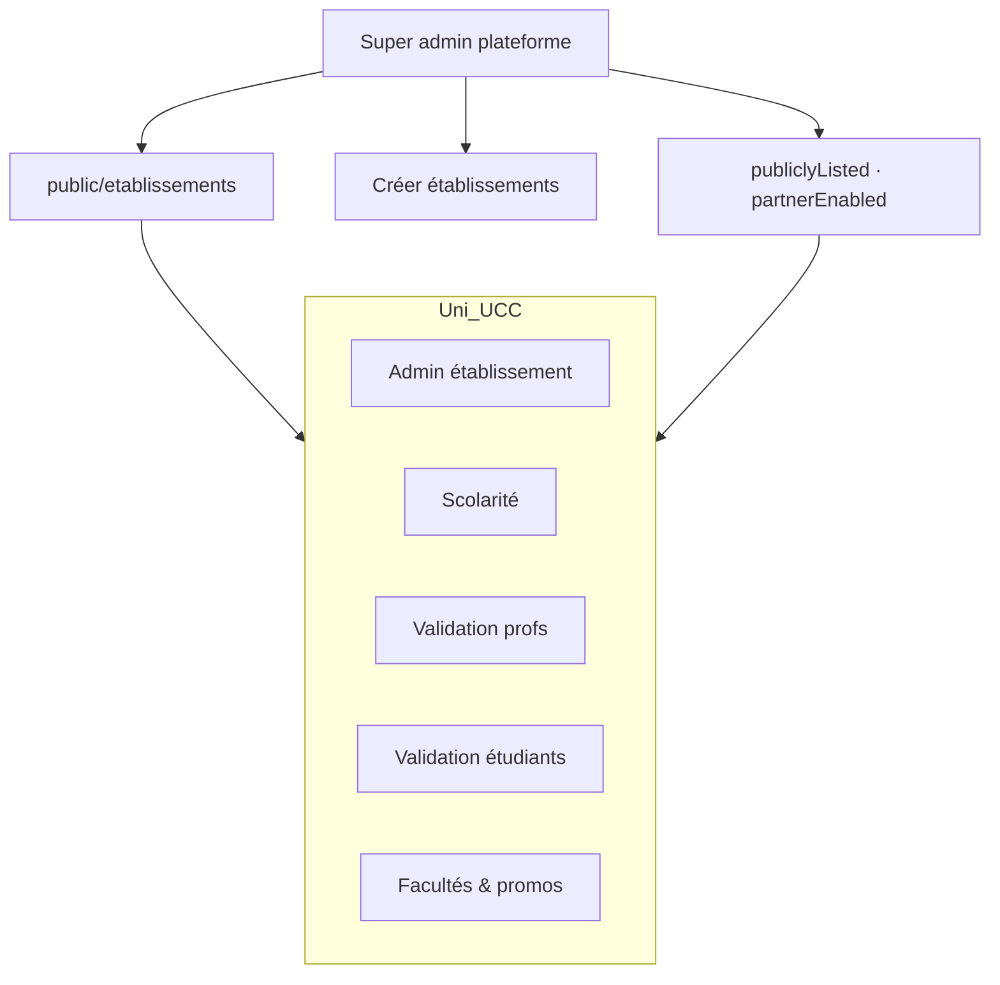

# Gouvernance multi-tenant — super admin, établissements, rôles

Modèle cible pour **plusieurs universités** sur une même plateforme LawApp.

---

## 1. Deux niveaux d’administration



| Niveau | Qui | Périmètre |
|--------|-----|----------|
| **Super admin** | Équipe LawApp / opérateur plateforme | Tous les établissements ; active qui apparaît en **public** ; comptes super admin |
| **Admin établissement** (+ rôles délégués) | IT / direction / scolarité **d’une** université | Un seul `etablissementId` ; validations et référentiels **scoped** |

Aujourd’hui en front : super admin ≈ compte **`certified`** → `/admin`. Espace établissement → `/institution` si `user.institutionMemberships[]` (à alimenter par l’API).

---

## 2. GET public des universités

**Route existante :** `GET /api/v1/public/etablissements`

**Comportement cible :**

| Champ (entité) | Défini par | Effet |
|----------------|------------|--------|
| `active` | Super admin | Établissement existe mais peut être totalement masqué |
| `publiclyListed` | Super admin | Apparaît dans la **liste publique** (annuaire) |
| `partnerEnabled` | Super admin | Prof / étudiant peut **choisir** cet établissement (affiliation, éval université) |

Règle : `partnerEnabled` implique en général `publiclyListed` et `active`.

**Front (d’ici API) :** flags locaux via `platformGovernance` store (`AdminCatalogPanel` — toggles super admin).

---

## 3. Rôles par établissement

| Rôle | Code | Valide profs | Valide étudiants | Facultés / promos |
|------|------|--------------|------------------|-------------------|
| Administrateur établissement | `institution_admin` | oui | oui | oui |
| Scolarité | `scolarite` | oui | oui | lecture |
| Validation enseignants | `validator_teacher` | oui | non | non |
| Validation étudiants | `validator_student` | non | oui | non |
| Référent académique | `faculty_manager` | non | non | oui |
| Lecture seule | `read_only` | non | non | lecture |

Un utilisateur peut avoir **plusieurs** `InstitutionMembership` (rare) ou un seul établissement + profil enseignant/étudiant.

Types front : `src/types/platformRoles.ts` · helpers : `src/utils/platformAccess.ts`.

---

## 4. Parcours métier

### 4.1 Super admin

1. Crée l’établissement (`POST private/etablissements`).
2. Active `publiclyListed` / `partnerEnabled`.
3. Crée le **premier** `institution_admin` (invitation e-mail ou liaison compte existant).
4. (Option) Crée promotions/facultés globales ou laisse l’établissement les gérer.

### 4.2 Admin établissement

1. Se connecte → `/institution` (dashboard scoped `etablissementId` du JWT).
2. **Files d’attente :**
   - enseignants `pending` (affiliation établissement) ;
   - étudiants `pending` (parcours académique) ;
   - évaluations `institution` en attente de co-validation.
3. Gère facultés & promotions **de son uni** uniquement.

### 4.3 Enseignant

- **Éval université** : choisit uni + faculté + promo dans le **référentiel admin** (ne crée rien).
- **Éval formation** : crée sa salle cohorte (hors tenant uni).

### 4.4 Étudiant

- Choisit un établissement **partnerEnabled** → parcours pending → validation **établissement**.

---

## 5. API backend à prévoir

### 5.1 Super admin (rôle `PLATFORM_SUPER_ADMIN`)

| Method | Path | Description |
|--------|------|-------------|
| GET | `private/platform/etablissements` | Tous + flags gouvernance |
| POST | `private/etablissements` | Créer |
| PATCH | `private/platform/etablissements/{id}` | `{ active, publiclyListed, partnerEnabled }` |
| POST | `private/platform/institution-memberships` | Inviter admin établissement |
| GET | `public/etablissements` | **Filtré** : `active && publiclyListed` |

### 5.2 Admin établissement (JWT scoped `etablissementId`)

| Method | Path | Description |
|--------|------|-------------|
| GET | `private/etablissements/me` | Infos + rôle courant |
| GET | `private/etablissements/me/dashboard` | Compteurs pending |
| GET | `private/etablissements/me/teacher-affiliations?status=pending` | |
| PUT | `private/etablissements/me/teacher-affiliations/{id}` | `{ action: verify \| reject, reason? }` |
| GET | `private/etablissements/me/student-paths?status=pending` | |
| PUT | `private/etablissements/me/student-paths/{id}` | verify / reject |
| GET | `private/etablissements/me/evaluation-publications?status=pending` | |
| PUT | `private/etablissements/me/evaluation-publications/{id}` | approve / reject |
| GET | `private/etablissements/me/faculties` | CRUD scoped |
| POST | `private/etablissements/me/faculties` | |
| GET | `private/etablissements/me/promotions` | Liées faculté / établissement |
| POST | `private/etablissements/me/promotions` | |

### 5.3 Login / profil

Enrichir `GET protected/me` :

```json
{
  "platformRole": "super_admin",
  "institutionMemberships": [
    {
      "etablissementId": 3,
      "etablissementLabel": "UCC",
      "role": "institution_admin",
      "active": true,
      "grantedAt": "2026-01-01T00:00:00Z"
    }
  ]
}
```

---

## 6. Front — état d’implémentation

| Élément | Statut |
|---------|--------|
| Types rôles | `platformRoles.ts` |
| Super admin UI toggles établissements | `AdminCatalogPanel` + `platformGovernance` store |
| Filtre listes partner / public | `CreateEvaluationView`, catalog |
| Dashboard établissement | `/institution` (files API à brancher) |
| Guard router | `requiresInstitutionStaff` |
| Certify user = super admin (démo) | `certified` → `/admin` |

---

## 7. Sécurité

- Toute route `…/etablissements/me/…` doit ignorer un `etablissementId` client : uniquement celui du **membership** JWT.
- Super admin ≠ admin UCC : séparation des claims.
- Audit log : qui a validé quel parcours / prof (ISO 27001 / RGPD).

---

*Voir aussi : [admin-referentiels-universites.md](./admin-referentiels-universites.md), [backend-user-journeys-api.md](./backend-user-journeys-api.md)*
