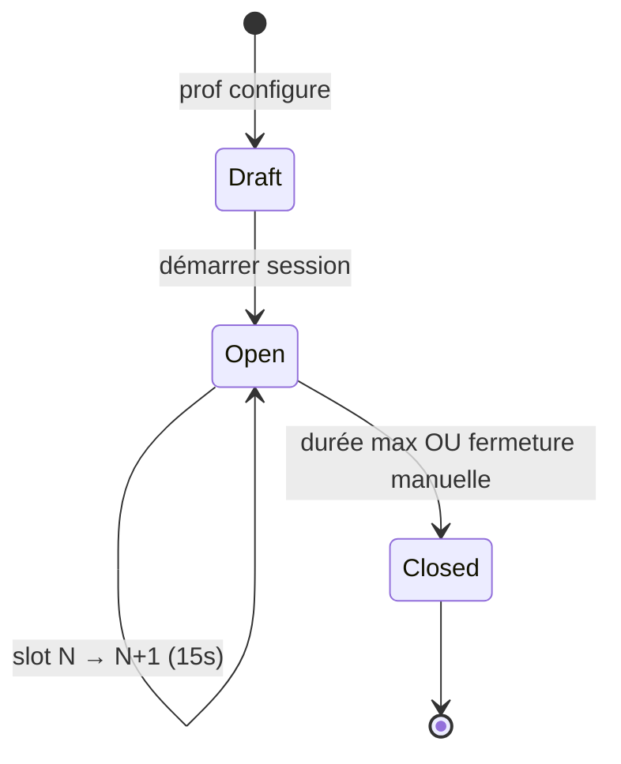

# Présence par QR dynamique — spec produit, API & UI/UX

Document de référence pour remplacer / compléter la présence WiFi locale (`PresenceSessionPanel`, `presentOnly` côté front) par un **registre serveur** : session à durée fixée par le prof, QR rotatif (~15 s), **relais étudiants révocables**, check-in authentifié (mobile + web), tentatives tardives traçables.

**Liens :** [Parcours & API backend](./backend-user-journeys-api.md) (§ Parcours F, endpoints §7.7, codes §9) · [Admin & salles](./admin-referentiels-universites.md)

---

## 1. Objectifs

| Objectif | Comment |
|----------|---------|
| Exclure les **absents** des épreuves « présents only » | Registre `present` sur **session** ; gate `resolve-code` / `start` |
| Fonctionner **sans vidéoprojecteur** | Prof + **relais** (CP) affichent le **même QR synchronisé** (serveur) |
| Limiter la réutilisation de captures | **Slots** signés ~15 s dans une fenêtre max (ex. 5 min) |
| Traçabilité pédagogique | Tentatives après slot ou après clôture → log + **explication étudiant** visible prof |
| Multi-canal | Scan depuis **app mobile LawApp** ou **web** (smartphone prioritaire ; PC avec fallback code numérique) |

Le WiFi / empreinte réseau reste une **option « campus strict »** ultérieure, pas le cœur du MVP présence.

---

## 2. Modèle conceptuel



| Entité | Description |
|--------|-------------|
| **PresenceSession** | Liée à `classroomId`, créée par enseignant ; `maxDurationSeconds`, `slotRotationSeconds` (défaut 15), `status` `open` \| `closed`, `openedAt`, `closedAt` |
| **PresenceSlot** | Index `slot` + `expiresAt` ; payload signé (`sig`) pour QR / code numérique |
| **PresenceCheckIn** | `(sessionId, studentUserId, checkedInAt, slotIndex?, relayUserId?)` — idempotent |
| **PresenceRelayGrant** | `(sessionId, studentUserId, grantedAt, revokedAt?, activeDeviceId?)` — temporaire, **par session** |
| **PresenceAttempt** | Échec check-in : `SLOT_EXPIRED`, `SESSION_CLOSED`, `INVALID_TOKEN`, `RELAY_REVOKED` ; optionnel `studentExplanation` |

**Autorité serveur :** les écrans prof / relais **pollent** (ou SSE) `GET …/display` ; le QR encode un **token court** ou une URL deep link, jamais un « fichier QR statique » partageable hors session.

---

## 3. Parcours enseignant

### 3.1 Démarrer une session

1. Depuis **salle / cours** (`CourseDetailView`, `TeacherAttendanceView`, ou panneau présence existant).
2. **Modal « Nouvelle présence »** :
   - Durée max : slider ou select (ex. 2–15 min, défaut 5).
   - Rotation slot : fixe 15 s (config plateforme plus tard).
   - Option : lier à une **évaluation** future `presentOnly` (liste des évals brouillon/publiées de la salle) — ou liaison manuelle après coup via `requiredPresenceSessionId`.
3. **Démarrer** → écran **session live** (voir §8.1).

### 3.2 Pendant la session (écran live)

- **QR plein écran** + **compte à rebours** slot (15 → 0) + barre progression session (5 min).
- **Code numérique 6 chiffres** (même slot) — accessibilité / appareil sans caméra arrière.
- Compteur **Présents** (live refresh).
- **Autoriser un relais** : recherche nom / liste inscrits → grant.
- Liste **Relais actifs** : nom, durée, **[Couper le relais]** ; action **Couper tous les relais**.
- **[Terminer la session]** (fermeture anticipée).
- Onglet / drawer **Tentatives** : slot expiré (bruit) vs session terminée (prioritaire) + textes explicatifs.

### 3.3 Relais (CP à l’instant T)

- Le prof **ne désigne pas** de CP permanent : il **choisit à l’instant** parmi les inscrits (confiance visuelle « présent en salle »).
- **Ne pas** exiger le statut `present` API pour devenir relais (au début de session, personne n’a encore scanné).
- Révocation **immédiate** : l’écran relais affiche « Relais désactivé par l’enseignant » ; plus de nouveaux slots pour ce compte/appareil.
- Les check-ins **déjà validés** via un relais révoqué **restent** ; audit log `relayUserId`.

**Mitigations :**

- Grant lié au **compte** CP + **1 appareil actif** (nouvelle session relais invalide l’ancien `deviceId`).
- Session courte + rotation 15 s.

---

## 4. Parcours relais (étudiant CP)

1. Notification in-app : « [Prof] vous autorise à afficher le QR de présence ».
2. Ouvre **Écran relais** (plein écran, luminosité max suggérée).
3. Même QR + countdown que le prof (poll serveur).
4. Si révoqué ou session closed → écran statique explicite (pas de QR).

**Permissions :** affichage seulement — pas fermer session, pas voir les tentatives tardives (sauf décision produit contraire).

---

## 5. Parcours étudiant — check-in

### 5.1 Canaux

| Canal | UX | Notes |
|-------|-----|-------|
| **Web smartphone** | Onglet « Pointer présence » → caméra `getUserMedia` → decode → `POST check-in` | Cas amphi standard |
| **App mobile** | Idem + deep link / intent depuis QR | Meilleure perf caméra |
| **Web PC** | Message : « Utilisez votre téléphone » + saisie **code 6 chiffres** affiché sur tablette prof/CP | Pas promouvoir webcam laptop |
| **Deep link QR** | `https://{host}/presence/check-in?token=…` → login si besoin → reprise token si slot encore valide | Token lié au slot |

Check-in = **`POST` authentifié** (compte étudiant). Le QR ne fait que transporter le **droit de pointer dans cette session à cet instant**.

### 5.2 Succès / échecs

| Réponse | UX étudiant |
|---------|-------------|
| `201` déjà present | « Vous êtes déjà marqué présent · {heure} » |
| `201` nouveau | Toast success + badge présence sur dashboard salle |
| `403 SLOT_EXPIRED` | « Ce QR n’est plus valide. Scannez le QR **actuellement** affiché. » (pas de formulaire long) |
| `403 SESSION_CLOSED` | Écran dédié §5.3 |
| `403 INVALID_TOKEN` | « QR non reconnu » (pas de formulaire — anti-spam) |
| `403 NOT_ENROLLED` | « Vous n’êtes pas inscrit à cette salle » |

### 5.3 Session terminée — formulaire explicatif

Écran :

- Titre : « La présence est terminée »
- Sous-texte : heure de clôture, nom du cours
- **Textarea obligatoire** : « Pourquoi tentez-vous de scanner maintenant ? »
- Bouton **Envoyer** → `POST …/attempts` avec `{ token?, explanation }`
- Limite : **1 explication** par `(user, session)` (ou cooldown 5 min)

Le prof reçoit une entrée dans **Tentatives tardives** (`SESSION_CLOSED`).

---

## 6. Lien avec les évaluations

| Règle prof | Backend |
|------------|---------|
| Évaluation **Présents uniquement** | `presentOnly: true`, `classroomId`, `requiredPresenceSessionId` **ou** règle « session du jour pour cette salle » |
| Code épreuve | `resolve-code` / `start` vérifie `PresenceCheckIn` pour l’utilisateur |

Ordre typique en examen :

1. Session présence (5 min, relais CP).
2. Prof ferme présence (ou fin auto).
3. Prof publie / ouvre épreuve liée → seuls les `present` passent le gate.

Codes d’erreur examen : `PRESENCE_REQUIRED`, `PRESENCE_SESSION_MISMATCH` (voir backend doc §9).

**Legacy front :** `presentOnly` + `courseStore.isPresent` local → migrer vers API check-ins.

---

## 7. API (résumé — détail dans backend doc §7.7)

Préfixe : `/api/v1`. Auth Bearer sauf mention.

| Method | Path | Acteur | Description |
|--------|------|--------|-------------|
| POST | `protected/classrooms/{classroomId}/presence-sessions` | Enseignant | Body: `{ maxDurationSeconds, slotRotationSeconds?, evaluationId? }` → session `open` |
| GET | `protected/presence-sessions/{id}` | Enseignant | Détail + stats |
| GET | `protected/presence-sessions/{id}/display` | Enseignant **ou** relay grant actif | `{ slot, expiresAt, numericCode, qrPayload, sessionRemainingSeconds }` |
| POST | `protected/presence-sessions/{id}/close` | Enseignant | Fermeture anticipée |
| GET | `protected/presence-sessions/{id}/check-ins` | Enseignant | Liste présents |
| POST | `protected/presence-sessions/{id}/relays` | Enseignant | Body: `{ studentUserId }` |
| DELETE | `protected/presence-sessions/{id}/relays/{studentUserId}` | Enseignant | Révoque relais |
| POST | `protected/presence-sessions/{id}/check-in` | Étudiant | Body: `{ token }` ou `{ sessionId, slot, sig }` |
| POST | `protected/presence-sessions/{id}/attempts` | Étudiant | Body: `{ token?, reasonCode, explanation? }` — log + explication si `SESSION_CLOSED` |
| GET | `protected/presence-sessions/{id}/attempts` | Enseignant | Tentatives (filtre `reasonCode`) |

**Token QR (exemple payload décodé) :**

```json
{
  "sessionId": "uuid",
  "slot": 42,
  "exp": 1730123456,
  "sig": "…"
}
```

---

## 8. UI/UX — écrans & navigation

### 8.1 Cartographie routes (cible)

| Route | Vue (proposée) | Rôle |
|-------|----------------|------|
| `/teacher/courses/:id/presence/live` | `TeacherPresenceLiveView.vue` | Enseignant — session live |
| `/teacher/courses/:id/presence/:sessionId` | Idem (deep link reprise) | Enseignant |
| `/presence/relay/:sessionId` | `PresenceRelayDisplayView.vue` | Étudiant CP — plein écran |
| `/presence/check-in` | `PresenceCheckInView.vue` | Étudiant — scan / code manuel |
| `/presence/check-in/late` | `PresenceLateAttemptView.vue` | Étudiant — session closed + formulaire |
| `/student/attendance` | Enrichir existant | Historique + bouton « Scanner présence » si session open sur une salle jointe |

**Points d’entrée enseignant (existants à étendre) :**

- `CourseDetailView.vue` — remplacer / compléter `PresenceSessionPanel` par CTA « Démarrer présence QR » + lien session live.
- `TeacherAttendanceView.vue` — liste sessions passées + présents / tentatives.
- `DashboardView.vue` — raccourci si session open sur une salle.

**Points d’entrée étudiant :**

- `StudentDashboardView.vue` — bannière « Présence en cours pour [Cours] » → check-in.
- `JoinView` / deep link depuis QR.

### 8.2 Wireframes logiques (ASCII)

**Enseignant — session live**

```
┌─────────────────────────────────────────────┐
│ Présence · Droit civil · 3:42 restantes      │
├─────────────────────────────────────────────┤
│  ┌─────────────┐   Présents: 87              │
│  │  [QR BIG]   │   Slot: 12s ████░░░         │
│  └─────────────┘   Code: 482 901             │
│  [ Plein écran QR ]                          │
├─────────────────────────────────────────────┤
│ Relais actifs                                │
│  • Marie K. (2:10)        [ Couper ]         │
│  • Paul M. (0:45)         [ Couper ]         │
│  [ + Autoriser un relais ]  [ Couper tous ]  │
├─────────────────────────────────────────────┤
│ [ Terminer la session ]    Tentatives (3) ▾  │
└─────────────────────────────────────────────┘
```

**Étudiant CP — relais**

```
┌─────────────────────────────────────────────┐
│ RELAIS PRÉSENCE — affichez aux camarades     │
│         ┌─────────────┐                        │
│         │  [QR BIG]   │     11 s               │
│         └─────────────┘                        │
│  (Luminosité · ne quittez pas l’écran)         │
└─────────────────────────────────────────────┘
```

**Étudiant — check-in (mobile web)**

```
┌─────────────────────────────────────────────┐
│ Pointer ma présence                          │
│  ┌─────────────────────────────────────┐    │
│  │      cadre caméra / scan             │    │
│  └─────────────────────────────────────┘    │
│  — ou saisir le code affiché —               │
│  [ ______ ]  [ Valider ]                     │
└─────────────────────────────────────────────┘
```

**Étudiant — session terminée**

```
┌─────────────────────────────────────────────┐
│ La présence est terminée (09:05)             │
│ Pourquoi scannez-vous maintenant ? *         │
│ ┌─────────────────────────────────────┐     │
│ │                                     │     │
│ └─────────────────────────────────────┘     │
│ [ Envoyer au professeur ]                    │
└─────────────────────────────────────────────┘
```

### 8.3 Composants UI réutilisables (design system existant)

| Composant | Usage |
|-----------|--------|
| `AppModal` | Création session (durée max) |
| `AppButton` | Terminer, couper relais, plein écran |
| `AppBadge` | Session open / closed, « Relais actif » |
| `AppCombobox` / `AppSuggest` | Recherche étudiant pour relais |
| `AppEmptyState` | Aucune tentative, aucun présent |
| `AppDataTable` | Liste présents, tentatives (prof) |
| `AppStepper` | Optionnel onboarding 1ère session |
| `AppCard` | Stats session dans historique |

**Nouveaux composants suggérés :**

| Composant | Responsabilité |
|-----------|----------------|
| `PresenceQrDisplay.vue` | QR + numeric code + countdown slot (props: `displayPayload` from API) |
| `PresenceRelayList.vue` | Liste grants + actions couper |
| `PresenceAttemptDrawer.vue` | Tentatives slot vs session closed |
| `PresenceScanner.vue` | Wrapper caméra + decode (web) ; fallback input code |
| `PresenceSessionTimer.vue` | Barre durée max session |

### 8.4 États & feedback

| État | Comportement |
|------|----------------|
| Poll display 2 s avant expiry slot | Précharge slot suivant (évite flicker) |
| Perte réseau prof | Bannière « Reconnexion… » ; session continue côté serveur |
| Relais révoqué mid-poll | 403 → écran statique immédiat |
| Session closed | Tous les écrans display → même écran « Terminé » |

### 8.5 Accessibilité & i18n

- Code numérique toujours visible à côté du QR.
- Annonce screen reader : « Nouveau code dans 10 secondes ».
- Clés i18n : `presence.error.SLOT_EXPIRED`, etc. alignées sur codes API.

---

## 9. Sécurité & vie privée

- Tokens signés HMAC ou JWT courte durée ; pas de `sessionId` seul dans le QR.
- Rate limit `check-in` / `attempts` par IP + user.
- Conservation `studentExplanation` : ex. 12 mois ; visible enseignant + admin établissement si litige.
- Logs `relayUserId` sur check-in pour audit.

---

## 10. Migration depuis le front actuel

| Existant | Évolution |
|----------|-----------|
| `PresenceSessionPanel.vue` | Devient lancement → redirect **session live** ; WiFi optionnel « mode legacy / campus+ » |
| `join/presence/:shareCode` | Migrer vers token session/slot ou redirect check-in |
| `utils/localNetwork.ts`, `wifiScan.ts` | Feature flag `presenceMode: qr \| wifi \| both` |
| `access.ts` `presentOnly` | Appeler API ou cache sync check-ins post-session |

---

## 11. Priorisation (avec backend)

| Vague | Livrable |
|-------|----------|
| **P1** | CRUD session + display slot + check-in + close |
| **P2** | Relais grants + relay display + révocation |
| **P3** | Attempts + formulaire tardif + UI prof tentatives |
| **P4** | Gate `presentOnly` sur `resolve-code` / `start` |
| **P5** | Option réseau campus + historique analytics |

---

## 12. Références code front (actuel & cible)

| Sujet | Fichier actuel | Cible |
|-------|----------------|-------|
| Panneau présence WiFi | `src/components/teacher/PresenceSessionPanel.vue` | Lancement → live view |
| Accès presentOnly | `src/utils/access.ts` | + API check-in |
| Types éval | `src/types/index.ts` | `requiredPresenceSessionId?` |
| Routes join | `src/router/index.ts` | `/presence/*` |
| Attendance UI | `TeacherAttendanceView.vue`, `StudentAttendanceView.vue` | Historique sessions QR |

---

*Dernière mise à jour : spec QR dynamique, relais révocables à l’instant T, tentatives tardives avec explication, UI/UX cible.*
